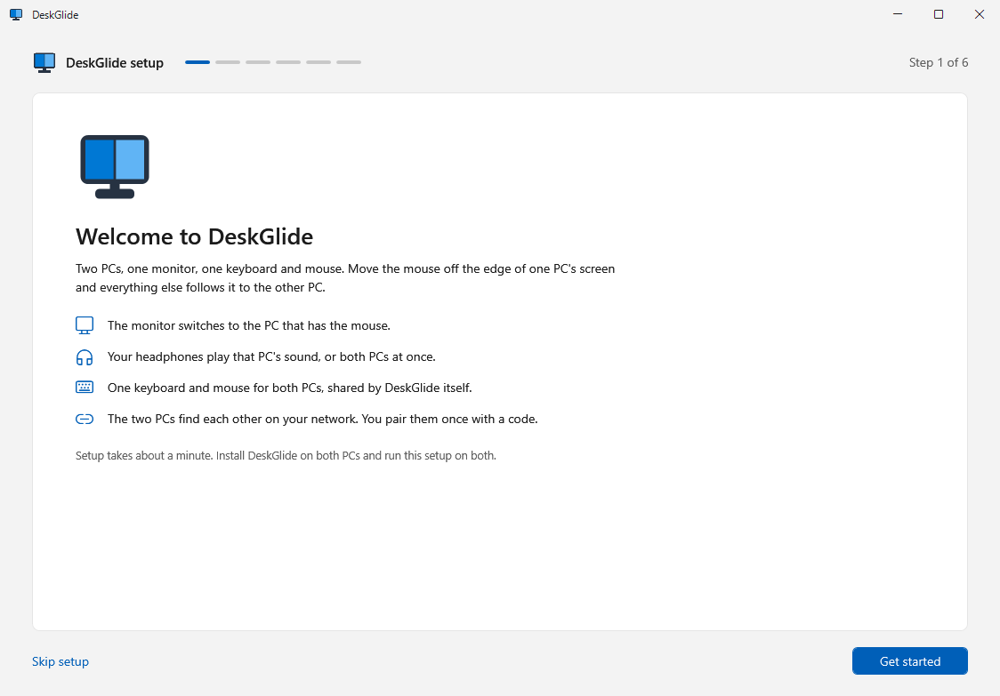

# DeskGlide

**Two Windows PCs at one desk, one set of everything: the monitor, your headphones, your microphone and your clipboard follow the mouse.**


<sub>Also in [dark](docs/window-dark.png). The window follows Windows' light or dark app theme.</sub>

<!-- Demo GIF: replace this comment with 

How to record it with Snipping Tool (built into Windows 11):
1. Press Win+Shift+R, drag a box around the monitor (or a phone camera pointed at the desk for the input switch), and click Start.
2. Move the mouse from one PC to the other and back, copy a file on one PC and paste it on the other, press Ctrl+Alt+Right.
3. Stop, then Save as docs\demo.mp4.
4. GitHub plays MP4 when you drag the file into the README editor on github.com; for a GIF, convert it
   (for example with ffmpeg: ffmpeg -i docs\demo.mp4 -vf "fps=12,scale=900:-1" docs\demo.gif) and keep it under 10 MB. -->

> **Demo GIF coming soon.** It will show the monitor following the mouse, sound switching, and a file copied on one PC pasted on the other.

```
 Synergy (keyboard + mouse) ── writes "switch from A to B" ──▶ its log
                                                                 │
 ┌──────────────────── DeskGlide, on each PC ────────────────────▼──┐
 │  reads the log, knows which PC has the mouse                     │
 │    ├─▶ DDC/CI (dxva2.dll) ──▶ monitor input: DisplayPort / HDMI  │
 │    ├─▶ WASAPI: sound out, headset microphone in ─┐               │
 │    └─▶ clipboard: copied files ──────────────────┤               │
 └──────────────────────────────────────────────────┼───────────────┘
                                                    ▼
      UDP control, HMAC-SHA256 signed   ·   UDP sound + mic, TCP files: AES-256 + HMAC
            keyed by a one-time pairing code (PBKDF2), stored with DPAPI
                                                    ▼
                                    DeskGlide on the other PC
                     (plays the sound, the mic into VB-Cable, pastes the files)
```

## How it works

- **Where the mouse is:** Synergy moves the keyboard and mouse between the PCs and writes `switch from "A" to "B"` to its log; DeskGlide reads that log.
- **Monitor:** DeskGlide tells the monitor to change its input over DDC/CI (VCP code 0x60) with `dxva2.dll`, which ships with Windows.
- **Sound:** WASAPI loopback captures the other PC's sound; DeskGlide sends it as 16-bit PCM over UDP and plays it with `winmm`.
- **Microphone:** WASAPI captures the headset microphone; the other PC plays it into VB-Audio Virtual Cable, which apps there use as a microphone.
- **Files:** a clipboard listener (`AddClipboardFormatListener`) notices copied files; the other PC pulls them over TCP when the mouse arrives and puts them on its clipboard.
- **Pairing and security:** a one-time code becomes a key (PBKDF2); messages are signed with HMAC-SHA256, and sound, microphone and files are encrypted with AES-256-CBC plus HMAC-SHA256. The key is stored with Windows DPAPI.
- **Finding each other:** UDP broadcast on every network adapter, with a typed address as a fallback (Tailscale, ZeroTier, a direct cable).
- **App:** one PowerShell script and one C# file compiled on the fly (`Add-Type`); a WPF window and a tray icon. Nothing to install but DeskGlide itself.

## Features

- **Monitor follows the mouse,** on every DDC/CI monitor you choose, each with its own input per PC. DeskGlide learns the inputs itself and checks that the monitor really switched.
- **Hotkeys:** Ctrl+Alt+Right shows the other PC, Ctrl+Alt+Left this one, without moving the mouse (configurable).
- **Sound:** hear the PC that has the mouse, or both at once, in the headphones on either PC. While you listen to the other PC, the headphones PC mutes its own apps.
- **Microphone:** your headset microphone works in apps on the other PC too (with VB-Cable there), all the time or only while the mouse is there.
- **Copy and paste files and folders** between the PCs: copy, move the mouse, press Ctrl+V in Explorer. Up to 2 GB by default.
- **Optional:** take a monitor that shows the other PC off this PC's desktop, so windows and the pointer can't get lost on it.
- **Layout editor:** drag the other PC's screen to where it sits, like Windows' display settings.
- **Setup guide, light and dark theme, tray icon** that shows which PC has the mouse.
- **Auto-update** from GitHub releases, SHA256-checked (once the repository is published).

Coming next: **DeskGlide Link,** DeskGlide's own keyboard and mouse sharing, so Synergy is no longer needed. The window already has its "Keyboard and mouse are plugged into" choice.

## Requirements

- Windows 10 or 11 on both PCs, on the same network (or see [PCs on different networks](#pcs-on-different-networks))
- A monitor with DDC/CI turned on (most have it on by default; look in the monitor's on-screen menu), connected to both PCs on different inputs
- Synergy on both PCs, sharing the keyboard and mouse (until DeskGlide Link)
- For the microphone: [VB-Audio Virtual Cable](https://vb-audio.com/Cable/) on the PC without the headphones

## Install

On **each** PC:

1. Download the latest `DeskGlide-<version>.zip` from Releases (or **Code > Download ZIP**) and extract it anywhere.
2. Double-click **Install.cmd**. If Windows asks whether to run it, choose **Run**.
3. If Windows Firewall asks about PowerShell, allow it on **Private networks**. The PCs can't find each other without this.

Install.cmd unblocks DeskGlide's files, copies them to `%LOCALAPPDATA%\DeskGlide\app` and runs them from there, so you can delete the downloaded folder. DeskGlide starts with Windows from then on; its icon is in the taskbar tray (maybe under the **^** arrow).

### The setup guide



1. **Welcome.**
2. **Pair:** on one PC click **Show a code on this PC**, type the code (like `K7MX-Q2PD`) on the other and click **Pair**. You do this once.
3. **Monitor:** move the mouse to each PC once and wait a few seconds; press the monitor's input button if the screen doesn't follow. A tick appears as DeskGlide learns each PC's input.
4. **Headphones:** pick the PC your headphones are plugged into. Both PCs share this choice.
5. **Done.**

Everything in the guide is also in the main window.

## Using it

| Card | What it does |
|---|---|
| **Layout** | Where the other PC's screen is. Drag it, or pick Left / Right / Above / Below. |
| **Monitor** | Monitor follows mouse; each monitor with "Switch with the mouse" and both PCs' inputs; **Switch monitor now** and **Test** (asks the monitor what it shows, switches nothing). |
| **Keyboard & mouse** | Which PC the keyboard and mouse are plugged into (shared; used by DeskGlide Link). |
| **Sound** | Follow mouse / Hear both / Off, the headphones PC, the other PC's volume, and a line that always says what you hear or why not. |
| **Microphone** | Follow mouse / Always / Off, and what's missing if it doesn't work (VB-Cable, the other PC). |
| **Pairing** | Show or type a code; Unpair. |
| **Copy files** | On or off, what was copied where, progress, and **Open received files** (`Downloads\DeskGlide`). |
| **Settings** | Start with Windows, Pause, taking switched monitors off the desktop, the Synergy log, the other PC's address, a script to run on every switch, the hotkeys, and the largest file copy. |

Settings that both PCs share (sound mode, headphones, microphone mode, monitors to switch, layout, keyboard PC) sync automatically; the newest change wins.

### Sound and microphone

| Sound | What you hear |
|---|---|
| **Follow mouse** (default) | Only the PC that has the mouse. While the mouse is on the other PC, this PC's apps are muted; apps you muted yourself stay muted. |
| **Hear both** | Both PCs mixed together. |
| **Off** | Nothing is sent. |

The **microphone** is the default microphone of the PC with the headphones. On the other PC, DeskGlide plays it into **CABLE Input**; choose **CABLE Output** as the microphone in Teams, Zoom, Discord and so on. VB-Cable's license doesn't allow DeskGlide to include or download it, so install it yourself from [vb-audio.com/Cable](https://vb-audio.com/Cable/) (it needs a restart).

### Copy and paste files

Copy files or folders in Explorer, move the mouse to the other PC, press **Ctrl+V**. DeskGlide pulls them when the mouse arrives, saves them in `Downloads\DeskGlide` (an existing name gets ` (2)`), and puts them on that PC's clipboard. A notification says when they're ready. Text and pictures are copied by Synergy as before.

### Hotkeys

**Ctrl+Alt+Right** shows the other PC and **Ctrl+Alt+Left** this one: the monitor and sound switch, the mouse stays where it is (handy to watch the other PC while you keep typing here). Change them in Settings; if another program already uses a key, Settings says so.

## PCs on different networks

DeskGlide finds the other PC with a network broadcast. Where broadcast doesn't reach, give it the other PC's address. The pairing code is still the only security step.

- **A direct Ethernet cable:** nothing to do; both ends get a `169.254.x.x` address and broadcast works.
- **Tailscale or ZeroTier:** pair as usual. The PC showing the code lists its addresses, for example `100.101.5.7 (Tailscale)`. If the other PC doesn't find it within about 10 seconds, type that address in the **Other PC's address** box and click **Connect** (also under Settings).
- **Phone hotspot or Wi-Fi that isolates devices:** the same address box.

## Tray menu

| Item | What it does |
|---|---|
| Open DeskGlide | Opens the window (or double-click the icon) |
| Monitor follows mouse | Switch the monitor when the mouse moves to the other PC |
| Sound | Follow mouse / Hear both / Off |
| Headphones are plugged into | This PC or the other one |
| Pause | Stop switching and sound until you uncheck it |
| Quit | Stop DeskGlide until the next login (closing the window only hides it) |

## Security

- **Control messages** carry an HMAC-SHA256 signature made with the pairing key, and a time stamp that must grow, so other devices can't control DeskGlide or replay old messages. They are not encrypted (they hold PC names, settings and the names of copied files).
- **Sound, microphone and files** are encrypted with AES-256-CBC and authenticated with HMAC-SHA256 (encrypt-then-MAC). Each sound stream and each file transfer uses its own key, made from the pairing key and fresh random values; every packet has a random IV. Anything changed on the way is dropped.
- **The pairing key** is stored in `config.json` encrypted with Windows DPAPI for your user account. Copying the config to another PC or user doesn't copy the pairing.
- **Downloads:** the only thing DeskGlide downloads is its own update, from its GitHub releases, checked against the release's SHA256 before use.

## Limits

- **Windows only,** both PCs.
- **Unsigned:** DeskGlide is a showcase project without a code-signing certificate, so Windows SmartScreen or your antivirus may warn when you run Install.cmd. Install.cmd unblocks only DeskGlide's own files.
- **Lock screen and UAC prompts:** DeskGlide runs as your user, so it can't act on the secure desktop: hotkeys and file paste don't work there, and DeskGlide Link won't reach it either.
- **Keyboard and mouse** need Synergy until DeskGlide Link ships.
- **Delay:** sound arrives 50-100 ms late on a home network: fine for music and video, noticeable in games.
- **Surround** sound is sent as stereo.
- **Identical monitors:** two monitors of the same model are told apart by their order, which can differ between the PCs.
- **Taking monitors off the desktop** is off by default: it couldn't be tested on a two-monitor setup yet, Windows rearranges windows each time, and it never applies to a PC's only screen. If a monitor stays off, press Win+P and choose Extend.

## Settings file

`%APPDATA%\DeskGlide\config.json` holds everything; quit DeskGlide before editing it. Two settings exist only there:

| Setting | Default | What it does |
|---|---|---|
| `inputOverride` | `0` | This PC's monitor input, if automatic detection gets it wrong: `15` = DisplayPort 1, `16` = DisplayPort 2, `17` = HDMI 1, `18` = HDMI 2 |
| `screenName` | computer name | This PC's screen name in Synergy, if it isn't the Windows computer name |

Network ports: UDP `6991` (finding each other, control), UDP `6990` (sound and microphone), TCP `6992` (files).

## Upgrading from DeskGlide 3

Do it on **both** PCs: DeskGlide 4 encrypts sound, so a DeskGlide 3 PC can't play it (the Sound card says so until both are updated). Quit DeskGlide from the tray, extract the new version and double-click **Install.cmd**. Your pairing is kept and its key is re-saved with DPAPI. Keep Synergy running.

## Uninstall

Double-click **Uninstall.cmd**. It stops DeskGlide, unmutes any app it muted, removes it from Startup and deletes `%LOCALAPPDATA%\DeskGlide`. Your settings stay in `%APPDATA%\DeskGlide`, and received files in `Downloads\DeskGlide`.

## Troubleshooting

Click **Open log** at the bottom of the window to see what DeskGlide saw and did.

- **"Looking for ...":** the PCs can't reach each other. Allow PowerShell through Windows Firewall on Private networks on both, use the same network (not a guest Wi-Fi), or set the other PC's address.
- **The monitor doesn't switch:** click **Test**. It says whether each monitor answers and which inputs DeskGlide knows. "Not learned yet": show that PC on the monitor once. Wrong input: set `inputOverride`.
- **"Didn't accept the switch":** turn on DDC/CI in the monitor's menu. Some monitors only accept input changes with the input set to manual rather than auto.
- **Nothing happens when the mouse crosses:** the Synergy log path is wrong or the log isn't written. Synergy's log is `%LOCALAPPDATA%\synergy-dragon\logs\synergy-dragon-agent.log`.
- **It always switches to the other input:** your Synergy screen name isn't the Windows computer name; set `screenName`.
- **No sound or microphone:** the line in the Sound or Microphone card says why.
- **Files don't arrive:** the Copy files card shows the error. Allow PowerShell through the firewall on the PC you copied on (TCP 6992), and check the size limit in Settings.
- **Windows rearranges after a switch:** some monitors drop the DisplayPort link when they change input. Try another cable or port, or turn off the monitor's "DP auto-switch" or deep-sleep option.
- **Debugging:** `powershell -ExecutionPolicy Bypass -File .\DeskGlide.ps1 -Console` runs with output to the console (quit the tray copy first); add `-ShowWindow` for the window. `-Test` runs the built-in self-check.

## For maintainers

- `powershell -ExecutionPolicy Bypass -File .\DeskGlide.ps1 -Test` runs the self-check: log parsing, pairing, encryption and tamper checks, audio packets, a real encrypted file transfer over loopback, monitor plans, hotkeys, settings sync, DPAPI migration, install, update download and swap.
- `Make-Release.ps1` builds `release\DeskGlide-<version>.zip` and `release\SHA256SUMS.txt` from the files at the top of the repository (no `.git`, no `docs`). Upload both to a release tagged `v<version>`.
- Auto-update is off until `$UpdateRepo` in `DeskGlide.ps1` names the GitHub repository (`owner/repo`).
- Screenshots: `DeskGlide.ps1 -Shot out.png -Theme light|dark -ShowWindow` renders the window off screen.

## Tested on

- Windows 11 with Synergy and an MSI monitor (DisplayPort + HDMI)
- Sound between two Windows PCs on the same Wi-Fi network

## Credits

- [VB-Audio Virtual Cable](https://vb-audio.com/Cable/) by VB-Audio Software (donationware, not included) makes the shared microphone possible.
- Synergy by Symless shares the keyboard and mouse until DeskGlide Link.

## License

MIT
