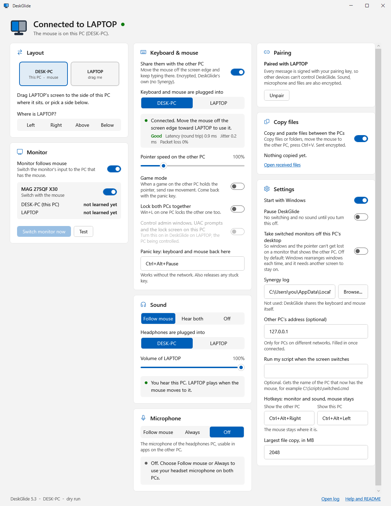

# DeskGlide

**Two Windows PCs at one desk, one set of everything: one keyboard and mouse for both (DeskGlide's own sharing), and the monitor, your headphones, your microphone and your clipboard follow the mouse.**



<sub>Also in [dark](docs/window-dark.png). The window follows Windows' light or dark app theme.</sub>

```
 keyboard + mouse ─▶ Raw Input / low-level hooks
                                 │
 ┌───────────────────── DeskGlide, on each PC ─────────────────────┐
 │  DeskGlide Link: knows which PC has the keyboard and mouse      │
 │    ├─▶ UDP: pointer positions, keys, buttons, wheel ──────┐     │
 │    ├─▶ DDC/CI (dxva2.dll) ──▶ monitor input: DP / HDMI    │     │
 │    ├─▶ WASAPI: sound out, headset microphone in ──────────┤     │
 │    └─▶ clipboard: files, text, pictures ──────────────────┤     │
 └───────────────────────────────────────────────────────────┼─────┘
                                                             ▼
  UDP control, HMAC-SHA256 signed  ·  UDP input, sound, mic and TCP files: AES-256 + HMAC
              keyed by a one-time pairing code (PBKDF2), stored with DPAPI
                                                             ▼
                                             DeskGlide on the other PC
           (moves the pointer and types, plays the sound, the mic into VB-Cable, pastes)
```

## How it works

- **Keyboard and mouse (DeskGlide Link):** the PC they are plugged into reads the mouse with Raw Input. When the pointer leaves the screen edge toward the other PC, low-level hooks hold local input back and DeskGlide sends it over UDP; the other PC injects it with `SendInput`. DeskGlide knows the other PC's monitors, so it sends exact pointer positions (a lost packet never shifts the pointer); keys, buttons and the wheel go on an acknowledged stream. This also tells DeskGlide which PC has the mouse.
- **Monitor:** DeskGlide tells the monitor to change its input over DDC/CI (VCP code 0x60) with `dxva2.dll`, which ships with Windows.
- **Sound:** WASAPI loopback captures the other PC's sound; DeskGlide sends it as 16-bit PCM over UDP and plays it with `winmm`.
- **Microphone:** WASAPI captures the headset microphone; the other PC plays it into VB-Audio Virtual Cable, which apps there use as a microphone.
- **Files, text and pictures:** a clipboard listener (`AddClipboardFormatListener`) notices what you copy; the other PC pulls it over TCP when the mouse arrives and puts it on its clipboard. If a firewall stops it connecting in (a company laptop, say), the PC you copied on connects out instead, so only one of the two PCs needs to accept connections.
- **Pairing and security:** a one-time code becomes a key (PBKDF2); messages are signed with HMAC-SHA256, and keyboard and mouse, sound, microphone and files are encrypted with AES-256-CBC plus HMAC-SHA256. The key is stored with Windows DPAPI.
- **Finding each other:** UDP broadcast on every network adapter, with a typed address as a fallback (Tailscale, ZeroTier, a direct cable).
- **App:** one PowerShell script and one C# file compiled on the fly (`Add-Type`); a WPF window and a tray icon. Nothing to install but DeskGlide itself.

## Features

- **One keyboard and mouse for both PCs,** DeskGlide's own: move the pointer off the screen edge and keep typing on the other PC. It enters at the same height on the other screen, scaled for each monitor's DPI, with a pointer speed slider. It reconnects by itself, and if the other PC goes away the keyboard and mouse come straight back with no key left pressed. A **panic key** (Ctrl+Alt+Pause) takes them back at any time, even without a network.
- **Monitor follows the mouse,** on every DDC/CI monitor you choose, each with its own input per PC. DeskGlide learns the inputs itself and checks that the monitor really switched.
- **Hotkeys:** Ctrl+Alt+Right shows the other PC, Ctrl+Alt+Left this one, without moving the mouse (configurable).
- **Sound:** hear the PC that has the mouse, or both at once, in the headphones on either PC. While you listen to the other PC, the headphones PC mutes its own apps.
- **Microphone:** your headset microphone works in apps on the other PC too (with VB-Cable there), all the time or only while the mouse is there.
- **Copy and paste files and folders** between the PCs: copy, move the mouse, press Ctrl+V in Explorer. Up to 2 GB by default. Text and pictures too (up to 32 MB).
- **Lock both PCs together** with Win+L (optional), and **game mode** for games that hold the pointer.
- **Admin control (optional):** with a small Windows service on the controlled PC, the keyboard and mouse also work in admin windows, UAC prompts and the lock and sign-in screen there, and Ctrl+Alt+End presses Ctrl+Alt+Del there. See [Admin control](#admin-control-optional).
- **Optional:** take a monitor that shows the other PC off this PC's desktop, so windows and the pointer can't get lost on it.
- **Layout editor:** drag the other PC's screen to where it sits, like Windows' display settings.
- **Live latency and packet loss** of the keyboard and mouse link in the window.
- **Setup guide, light and dark theme, tray icon** that shows which PC has the mouse.
- **Auto-update** from this repository's GitHub releases, SHA256-checked.

### DeskGlide Link vs others

What DeskGlide Link does about the problems people most often report with keyboard and mouse sharing tools:

| Reported elsewhere | What DeskGlide Link does |
|---|---|
| The pointer freezes and jumps; network work inside the input hook | Raw Input on its own thread; the hooks only hold input back (enqueue and return) |
| Clicks stop until a restart: Windows removed a slow hook | A passive watch: if Raw Input sees real input the hooks didn't within 200 ms, they are installed again; nothing is injected |
| Drift with fast mice; wrong speed across DPI; Windows' pointer acceleration applied twice | Absolute positions from a model of the other PC's monitors (physical pixels, per-monitor DPI), fractions kept, 1 ms coalescing, no acceleration; a speed slider |
| Never reconnects after an address change, sleep or the lock screen | Heartbeat every 250 ms (100 ms while a PC has control), lost after 1.5 s without any packet, a drop under 10 s resumes the same session, reconnects forever at most 2 s apart and at once after a network change, wake-up or unlock; the other PC is recognised by the pairing key, not its address |
| Stuck modifier keys | Every key carries all modifiers and the receiving PC corrects its own; on leave, loss or lock every held key and button is released on both PCs |
| AltGr arrives as Ctrl+Alt | AltGr's fake left Ctrl is dropped; keys go as scan codes |
| One refused input kills the connection | Refused input is counted and shown, never fatal; an admin window in front is detected and shown |
| Wrong network adapter (VPN, Hyper-V, VirtualBox) | Sends on the adapter whose subnet holds the other PC; virtual adapters only when nothing else does; with Ethernet and Wi-Fi both, on both |
| Jumps and lost keys on Wi-Fi or a hotspot | Each mouse packet carries the 3 positions before it; keys and buttons go twice and are resent after an RTT-based timeout until acknowledged; input marked as control traffic (qWAVE); the window shows round trip, jitter, loss and a Good/Fair/Poor badge, and a tip when Wi-Fi power saving is on |
| Small scroll steps dropped | Wheel and horizontal wheel deltas forwarded unchanged, plus the side buttons |
| Games spin | No crossing while a game holds the pointer; optional game mode sends raw movement |
| The clipboard hangs the connection | Clipboard on its own TCP channel, pulled when the mouse arrives, capped at 32 MB, never on the input path |
| A version mismatch shows as a wrong key | The handshake carries the version and says which PC to update |
| The controlled PC falls asleep | The keyboard PC stays awake only while its input went to the other PC in the last 5 minutes; the controlled PC follows its own timers, its injected input counts as use |
| Busy CPU while idle | Idle wake-ups every 20 ms; 1 ms timing only while the other PC has control |
| No input at UAC prompts or the lock screen, or a service any program can drive | Optional SYSTEM service with its own key that programs on the PC can't read; settings only from an elevated administrator ([Security model](#security-model)) |

Also: a local panic key, Win+L on both PCs, the entry point following the pointer's position along the edge, and live latency and loss. Tested over loopback so far: from input to injection 0.4 ms (median) for pointer moves and keys, under 3.5 ms at the 99th percentile, with every key delivered once and in order at 30% packet loss each way; with 10% loss, 0 to 50 ms jitter and a 300 ms outage, no cursor jumps, every key in order, control kept, keys through about 0.2 s after the outage.

## Requirements

- Windows 10 or 11 on both PCs, on the same network (or see [PCs on different networks](#pcs-on-different-networks))
- A monitor with DDC/CI turned on (most have it on by default; look in the monitor's on-screen menu), connected to both PCs on different inputs
- For the microphone: [VB-Audio Virtual Cable](https://vb-audio.com/Cable/) on the PC without the headphones

## Install

On **each** PC:

1. Download the latest `DeskGlide-<version>.zip` from Releases (or **Code > Download ZIP**) and extract it anywhere.
2. Double-click **Install.cmd**. If Windows asks whether to run it, choose **Run**.
3. If Windows Firewall asks about PowerShell, allow it on **Private networks**. The PCs can't find each other without this.

Install.cmd unblocks DeskGlide's files, copies them to `%LOCALAPPDATA%\DeskGlide\app` and runs them from there, so you can delete the downloaded folder. It adds a **DeskGlide** shortcut to the Start menu and the Desktop (it opens the window, or brings up the one already running) and starts DeskGlide with Windows; turn that off in Settings, the tray menu or the last page of the setup guide. Its icon is in the taskbar tray (maybe under the **^** arrow).

### The setup guide


1. **Welcome.**
2. **Pair:** on one PC click **Show a code on this PC**, type the code (like `K7MX-Q2PD`) on the other and click **Pair**. You do this once.
3. **Keyboard and mouse:** pick the PC they are plugged into. Both PCs share this choice.
4. **Monitor:** move the mouse to each PC once and wait a few seconds; press the monitor's input button if the screen doesn't follow. A tick appears as DeskGlide learns each PC's input.
5. **Headphones:** pick the PC your headphones are plugged into. Both PCs share this choice.
6. **Done.**

Everything in the guide is also in the main window. On the PC being controlled, step 3 also offers the optional [admin control](#admin-control-optional).

### Admin control (optional)

Windows keeps normal apps, DeskGlide included, out of admin windows, UAC prompts, the lock and sign-in screen and Ctrl+Alt+Del. To control those on the other PC too, do this once **on the PC being controlled** (the one the keyboard and mouse are *not* plugged into), with DeskGlide 5.3.1 or newer running on both PCs:

1. In the **Keyboard & mouse** card, turn on **Control admin windows, UAC prompts and the lock screen on this PC** (or click **Set up admin control...** in step 3 of the setup guide) and read the short explanation.
2. Windows asks for permission (UAC): use this PC's own keyboard and mouse to click **Yes**. A DeskGlide admin window opens, installs the service and contacts the other PC.
3. The admin window shows a six-digit number, and DeskGlide on the other PC shows one too (a notification and the Keyboard & mouse card). If they are the same, type `y` there and press Enter.
4. It asks whether to allow **Ctrl+Alt+Del**: you press **Ctrl+Alt+End** on the keyboard PC and the controlled PC gets Ctrl+Alt+Del (as in Remote Desktop). Allowing it changes one Windows policy (below); type `y` for yes or just press Enter for no.

The card then says **Admin control: on (service)**. To remove it, turn the switch off (Windows asks for permission again); Uninstall.cmd removes it too.

## Using it

| Card | What it does |
|---|---|
| **Layout** | Where the other PC's screen is. Drag it, or pick Left / Right / Above / Below. |
| **Monitor** | Monitor follows mouse; each monitor with "Switch with the mouse" and both PCs' inputs; **Switch monitor now** and **Test** (asks the monitor what it shows, switches nothing). |
| **Keyboard & mouse** | Share them on or off (both PCs), which PC they are plugged into, what the link is doing with its latency and packet loss, the pointer speed on the other PC, game mode, locking both PCs together, and the panic key. |
| **Sound** | Follow mouse / Hear both / Off, the headphones PC, the other PC's volume, and a line that always says what you hear or why not. |
| **Microphone** | Follow mouse / Always / Off, and what's missing if it doesn't work (VB-Cable, the other PC). |
| **Pairing** | Show or type a code; Unpair. |
| **Copy files** | On or off, what was copied where, progress, and **Open received files** (`Downloads\DeskGlide`). |
| **Settings** | Start with Windows, Pause, taking switched monitors off the desktop, the other PC's address, a script to run on every switch, the hotkeys, and the largest file copy. |

Settings that both PCs share (sound mode, headphones, microphone mode, monitors to switch, layout, keyboard PC, keyboard and mouse sharing, locking together) sync automatically; the newest change wins.

### Keyboard and mouse

Move the pointer off the screen edge toward the other PC (the Layout card says which edge) and the keyboard and mouse work there; move back across the opposite edge to return. The corners don't switch, so you can still reach a corner's buttons. **Ctrl+Alt+Pause** (the panic key, changeable in the card) brings them back to this PC at once and releases every key.

- **Pointer speed:** DeskGlide reads the mouse's raw movement and scales it by the two monitors' DPI. If the other PC feels slower or faster than this one (Windows' "Enhance pointer precision" isn't applied there), move the slider.
- **Games on this PC:** while a game runs in exclusive full screen or keeps the cursor inside its window, the pointer never leaves this PC, game mode or not, so it can't slip to the other PC mid-game. A borderless-windowed game that doesn't hold the cursor looks like any other window: the pointer can cross there, so use exclusive full screen.
- **Game mode** is for playing a game on the *other* PC with this PC's mouse. Normally DeskGlide sends exact pointer positions; while a game there holds the pointer, game mode sends the mouse's raw movement instead, as if the mouse were plugged into that PC, so the camera turns instead of spinning. It switches back by itself when the game lets go. Come back with the panic key. It doesn't change latency: both ways use the same 1 ms packets. It needs the normal app on the other PC: with admin control on there, the service can't see that PC's games.
- **Latency** is mostly the network's: DeskGlide itself adds well under a millisecond. Ethernet (or a home router) is steadier than a phone hotspot; the Keyboard & mouse card shows the round trip, jitter, loss and a Good/Fair/Poor badge.
- **Lock both PCs together:** Win+L on either PC locks the other one too.

### Sound and microphone

| Sound | What you hear |
|---|---|
| **Follow mouse** (default) | Only the PC that has the mouse. While the mouse is on the other PC, this PC's apps are muted; apps you muted yourself stay muted. |
| **Hear both** | Both PCs mixed together. |
| **Off** | Nothing is sent. |

The **microphone** is the default microphone of the PC with the headphones. On the other PC, DeskGlide plays it into **CABLE Input**; choose **CABLE Output** as the microphone in Teams, Zoom, Discord and so on. VB-Cable's license doesn't allow DeskGlide to include or download it, so install it yourself from [vb-audio.com/Cable](https://vb-audio.com/Cable/) (it needs a restart).

VB-Cable's installer may make **CABLE Input** that PC's default speaker. Then its sound goes nowhere and the microphone comes back as its sound; DeskGlide's Sound card says so on both PCs. Set the real speakers as the default again (Win+R, `mmsys.cpl`, Playback, Set Default). Sound and microphone use one UDP port (6990) both ways, with a keepalive, so they also work when one PC's firewall blocks connections in.

### Copy and paste files

Copy files or folders in Explorer, move the mouse to the other PC, press **Ctrl+V**. DeskGlide pulls them when the mouse arrives, saves them in `Downloads\DeskGlide` (an existing name gets ` (2)`), and puts them on that PC's clipboard. A notification says when they're ready. Text and pictures work the same way. Only one of the two PCs needs to accept connections: if a firewall you can't change blocks them on one PC (a company laptop, say), that PC connects out to the other instead.

### Hotkeys

**Ctrl+Alt+Right** shows the other PC and **Ctrl+Alt+Left** this one: the monitor and sound switch, the mouse stays where it is (handy to watch the other PC while you keep typing here). Change them in Settings; if another program already uses a key, Settings says so.

## PCs on different networks

DeskGlide finds the other PC with a network broadcast. Where broadcast doesn't reach, give it the other PC's address. The pairing code is still the only security step.

- **A direct Ethernet cable:** nothing to do; both ends get a `169.254.x.x` address and broadcast works.
- **Tailscale or ZeroTier:** pair as usual. The PC showing the code lists its addresses, for example `100.101.5.7 (Tailscale)`. If the other PC doesn't find it within about 10 seconds, type that address in the **Other PC's address** box and click **Connect** (also under Settings).
- **Phone hotspot or Wi-Fi that isolates devices:** the same address box.

## Tray menu

| Item | What it does |
|---|---|
| Open DeskGlide | Opens the window (or double-click the icon) |
| Monitor follows mouse | Switch the monitor when the mouse moves to the other PC |
| Sound | Follow mouse / Hear both / Off |
| Headphones are plugged into | This PC or the other one |
| Pause | Stop switching and sound until you uncheck it |
| Start with Windows | Start DeskGlide when you sign in (checked by default) |
| Quit | Stop DeskGlide until the next login, or until you open it from the Start menu or Desktop shortcut (closing the window only hides it) |

## Security

- **Keyboard and mouse** travel encrypted with AES-256-CBC and HMAC-SHA256 under a key for each session (the pairing key with fresh random values from both PCs); anything changed, replayed or from another key is dropped. A new session starts after every loss.
- **Control messages** carry an HMAC-SHA256 signature made with the pairing key, and a time stamp that must grow, so other devices can't control DeskGlide or replay old messages. They are not encrypted (they hold PC names, settings and the names of copied files).
- **Sound, microphone and files** are encrypted with AES-256-CBC and authenticated with HMAC-SHA256 (encrypt-then-MAC). Each sound stream and each file transfer uses its own key, made from the pairing key and fresh random values; every packet has a random IV. Anything changed on the way is dropped.
- **The pairing key** is stored in `config.json` encrypted with Windows DPAPI for your user account. Copying the config to another PC or user doesn't copy the pairing.
- **Downloads:** the only thing DeskGlide downloads is its own update, from its GitHub releases, checked against the release's SHA256 before use.

### Security model

Admin control needs a Windows service running as SYSTEM, the most powerful account on the PC: it can type into UAC prompts and the sign-in screen. It's built so that a program running as you, without admin rights, **can't use it to gain admin rights or control**:

- **Its programs live where only administrators can change them:** `C:\Program Files\DeskGlide` (users can read, not write). The setup, which runs elevated after the UAC prompt, copies DeskGlide's service sources there and compiles them there with the C# compiler that comes with Windows. The service refuses to start, and to start its helper, if the program or its folder could be changed by anyone but SYSTEM, Administrators or TrustedInstaller. Nothing runs from `%LOCALAPPDATA%` or another folder you can write to. Like any installer, the setup trusts DeskGlide's files as they are when you click Yes.
- **It runs as LocalSystem and owns the receiving side of DeskGlide Link** on that PC: the UDP port (6993, bound exclusively), the session encryption and the reliable stream. The DeskGlide app there stops receiving and shows **Admin control: on (service)**. Sending (sharing the keyboard PC's own keyboard and mouse) stays in the normal app, with no service involved.
- **It has its own key.** The normal pairing key is readable by programs running as you, so it isn't enough: the service's key comes from a new exchange (ECDH P-256) between the elevated setup and the other PC, and you confirm it by comparing a six-digit number on both screens. A program in the middle would make the numbers differ. The key is stored in `C:\ProgramData\DeskGlide\service`, which only SYSTEM and Administrators can open (if another program made that folder first, it's removed and made again), encrypted with DPAPI as SYSTEM, and never goes back to the normal app. The keyboard PC keeps its copy DPAPI-protected in its own settings.
- **Only an elevated administrator can change it.** Its control pipe lets SYSTEM and Administrators in fully, the signed-in user read and write, and nobody over the network. Anyone it lets in may ask for its **status** and **panic** (release every key and end control). Pairing, unpairing, turning it on or off and settings are accepted only from a caller whose token is elevated and in the Administrators group (checked on the caller's own token); anything else is refused and logged. The app talks to the pipe only after checking that it's the service's program from Program Files running in session 0, not another program using its name.
- **Input reaches the screen through a helper.** The service starts `DeskGlideHelper.exe` (from the same protected folder) in the session at the console, on the desktop that has the input: the normal desktop, a UAC prompt or the lock screen. They talk over two anonymous pipes the helper inherits, and it inherits nothing else, so no other program can connect to it. The helper only injects keys and mouse input the service sends, with only the flags DeskGlide uses, and never opens a network connection. It checks every 100 ms which desktop has the input and moves to a new one on a fresh thread; the service starts exactly one helper and starts it again after a session change or a crash.
- **Ctrl+Alt+Del** is pressed by the service with SendSAS, only if you allowed it in the setup. That sets the Windows policy *Disable or enable software Secure Attention Sequence* (`HKLM\SOFTWARE\Microsoft\Windows\CurrentVersion\Policies\System`, `SoftwareSASGeneration` = 1) so that services may press it; other services could too, but they already run as SYSTEM. DeskGlide remembers the value from before and puts it back when admin control is turned off.
- **Network input counts only from the paired PC's authenticated session.** Packets from other sessions are dropped before any decryption, connection attempts (hellos) are limited to 20 a second, and everything else is checked with the service's key before anything happens.
- **Removing it** (turning the switch off, or Uninstall.cmd), elevated: the service is stopped and deleted, `C:\Program Files\DeskGlide` and `C:\ProgramData\DeskGlide\service` are removed, and the Ctrl+Alt+Del policy is restored.

## Limits

- **Windows only,** both PCs, and **exactly two PCs** (not three or more).
- **Win+L and Ctrl+Alt+Del** always act on the PC whose keyboard pressed them; Windows lets no program pass them on. To lock only the other PC, press Ctrl+Alt+End (with admin control) and choose Lock, or turn on **Lock both PCs together**.
- **Unsigned:** DeskGlide is a showcase project without a code-signing certificate, so Windows SmartScreen or your antivirus may warn when you run Install.cmd. Install.cmd unblocks only DeskGlide's own files.
- **Lock screen, UAC prompts, admin windows and Ctrl+Alt+Del:** without [admin control](#admin-control-optional), DeskGlide runs as your user, so it can't type into admin windows (Task Manager, installers) or on the other PC's secure desktop (lock screen, UAC prompts), and Ctrl+Alt+Del can't be sent; the card says when Windows refuses input. With admin control they work, Ctrl+Alt+Del as Ctrl+Alt+End. Setting it up needs one UAC prompt on the controlled PC, which you answer with that PC's own mouse.
- **Admin control** works on a second PC for admin windows, UAC prompts, the taskbar and signing in on the lock screen; Ctrl+Alt+End is not tested on real PCs yet. It can't detect games on the controlled PC (game mode needs the normal app there), and Lock both PCs together doesn't lock a PC whose service receives. While it's on, that PC can't be the keyboard PC: turn it off first. Auto-update doesn't touch the installed service (that needs Windows' permission): after an update, turn admin control off and on again to rebuild it.
- **Games** on the other PC need game mode, and a borderless-windowed game on this PC doesn't stop the pointer crossing (see [Keyboard and mouse](#keyboard-and-mouse)).
- **Microphone** needs VB-Cable, a driver that takes administrator rights to install (a company laptop may not allow it). On that PC, choose **CABLE Output** as the default microphone (Win+R, `mmsys.cpl`, Recording) or in each app; keep its real speakers (or the monitor) as the default speaker.
- **Headphones moved to the other PC** aren't noticed: change **Headphones are plugged into**, and the two PCs' default speaker and microphone, yourself.
- **Keyboard layouts:** keys are sent as scan codes, so both PCs should use the same layout.
- **Pen tablets** and other absolute pointing devices only click on the other PC; they don't move its pointer.
- **Delay:** sound arrives a little late: about 50 ms on a cable, more on Wi-Fi or a phone hotspot, where DeskGlide's buffer grows by itself (up to 120 ms) whenever late packets would make the sound break up, and shrinks again when the network is calm. The Sound card says when it has grown. Fine for music and video, noticeable in games.
- **Surround** sound is sent as stereo.
- **Identical monitors:** two monitors of the same model are told apart by their order, which can differ between the PCs.
- **Taking monitors off the desktop** is off by default: it couldn't be tested on a two-monitor setup yet, Windows rearranges windows each time, and it never applies to a PC's only screen. If a monitor stays off, press Win+P and choose Extend.

## Settings file

`%APPDATA%\DeskGlide\config.json` holds everything; quit DeskGlide before editing it. Two settings exist only there:

| Setting | Default | What it does |
|---|---|---|
| `inputOverride` | `0` | This PC's monitor input, if automatic detection gets it wrong: `15` = DisplayPort 1, `16` = DisplayPort 2, `17` = HDMI 1, `18` = HDMI 2 |

Network ports: UDP `6991` (finding each other, control), UDP `6990` (sound and microphone), TCP `6992` (files, text and pictures), UDP `6993` (keyboard and mouse; with admin control, the service holds it on the controlled PC).

## Updating

DeskGlide offers new releases itself. To update by hand, quit DeskGlide from the tray on **both** PCs, extract the new version and double-click **Install.cmd**; your pairing and settings are kept. With admin control on, turn it off and on once afterwards so the service is rebuilt.

## Uninstall

Double-click **Uninstall.cmd**. If admin control is installed, it first removes it (Windows asks for permission). It stops DeskGlide, unmutes any app it muted, removes it from Startup and deletes `%LOCALAPPDATA%\DeskGlide`. Your settings stay in `%APPDATA%\DeskGlide`, and received files in `Downloads\DeskGlide`.

## Troubleshooting

Click **Open log** at the bottom of the window to see what DeskGlide saw and did.

- **"Looking for ...":** the PCs can't reach each other. Allow PowerShell through Windows Firewall on Private networks on both, use the same network (not a guest Wi-Fi), or set the other PC's address.
- **The monitor doesn't switch:** click **Test**. It says whether each monitor answers and which inputs DeskGlide knows. "Not learned yet": show that PC on the monitor once. Wrong input: set `inputOverride`.
- **"Didn't accept the switch":** turn on DDC/CI in the monitor's menu. Some monitors only accept input changes with the input set to manual rather than auto.
- **The pointer doesn't cross:** the Keyboard & mouse card says why (waiting for the other PC, another sharing app still running, the other PC needs an update). Check the Layout card's side, and that a game isn't holding the pointer. "Waiting for": allow PowerShell through Windows Firewall on Private networks (UDP 6993) on both PCs.
- **A key seems stuck:** press the panic key (Ctrl+Alt+Pause); it releases every key on this PC and, when connected, on the other one.
- **No sound or microphone:** the line in the Sound or Microphone card says why.
- **Files don't arrive:** the Copy files card shows the error. Files and copied text travel over TCP 6992. Since 5.3 it's enough for *one* of the two PCs to accept connections there: if the PC you copied on blocks them (a company laptop's firewall, say), it connects out to the other PC instead. If both block it, allow PowerShell through the firewall on one of them. Also check the size limit in Settings.
- **Windows rearranges after a switch:** some monitors drop the DisplayPort link when they change input. Try another cable or port, or turn off the monitor's "DP auto-switch" or deep-sleep option.
- **Debugging:** `powershell -ExecutionPolicy Bypass -File .\DeskGlide.ps1 -Console` runs with output to the console (quit the tray copy first); add `-ShowWindow` for the window. `-Test` runs the built-in self-check. `-NoInject` runs keyboard and mouse sharing without hooks or injection and logs what it would type.

## For maintainers

- `powershell -ExecutionPolicy Bypass -File .\DeskGlide.ps1 -Test` runs the self-check: log parsing, pairing, encryption and tamper checks, audio packets, a real encrypted file and clipboard transfer over loopback, monitor plans, hotkeys, settings sync, DPAPI migration, install, update download and swap, and DeskGlide Link: packets and tampering, coalescing, modifiers, AltGr, release-all, edges, entry points, DPI, the reliable stream, absolute coordinates on 100/125/150% layouts, heartbeat, loss and backoff, round trip and resend timeout, adapter choice and a second path, the hook watch, keeping awake, connection quality, Wi-Fi power saving and made-up Raw Input and hook events, then two engines over loopback UDP (crossing, keys, panic key, game mode, 30% packet loss, a hotspot with loss, jitter and an outage, losing and regaining the link, a restart, a version mismatch) with latency figures. Then admin control: it builds the service and helper into a temp folder, runs `DeskGlideService.exe -SelfTest` (the pipe's authorization matrix, ACLs, refusing user-writable folders, key storage, the Ctrl+Alt+Del policy on a test key under HKCU, the helper's frames, the pairing exchange), then runs the service in its test mode (`-Console`, as you, temp folder, own pipe, `-NoInject`) receiving from an engine over loopback: moves, keys, Ctrl+Alt+End, status, refused admin commands, panic and a hello flood. No input is injected, no hook is installed, nothing is installed and nothing elevated runs.
- `Make-Release.ps1` builds `release\DeskGlide-<version>.zip` and `release\SHA256SUMS.txt` from the files at the top of the repository (no `.git`, no `docs`). Upload both to a release tagged `v<version>`.
- Auto-update: once a day DeskGlide checks the latest release of `$UpdateRepo` in `DeskGlide.ps1` (this repository) and offers a newer `DeskGlide-*.zip`, checked against its SHA-256. Forks: set it to your own `owner/repo`, or to empty for no checks.
- Screenshots: `DeskGlide.ps1 -Shot out.png -Theme light|dark -ShowWindow` renders the window off screen.

## Tested on

- Two real PCs, a Windows 11 desktop and a Windows laptop, sharing one monitor (DisplayPort + HDMI) over Wi-Fi: the monitor following the mouse, keyboard and mouse sharing, admin control (admin windows, UAC prompts, the taskbar, signing in on the lock screen), copying text and files both ways, and the laptop's sound in the desktop's headphones with the headset microphone used by apps on the laptop (VB-Cable), with the laptop's firewall blocking connections in
- The self-check (`-Test`) on Windows 11: two engines over loopback for latency, loss and outages, and the admin service in its test mode with its security checks
- Not yet on real PCs: Ctrl+Alt+End through admin control, game mode, the second network path (two networks between the PCs at once, such as Wi-Fi and a cable)

## Credits

- [VB-Audio Virtual Cable](https://vb-audio.com/Cable/) by VB-Audio Software (donationware, not included) makes the shared microphone possible.

## License

MIT
